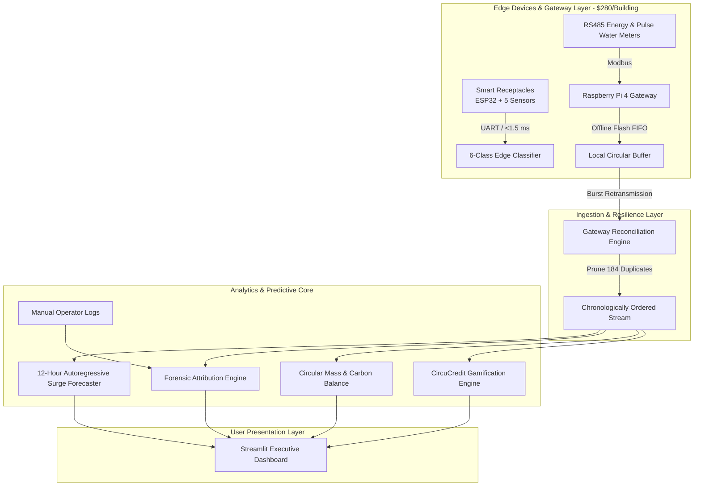

# 🌱 CircuPulse Campus — Predictive Circular-Resource Grid
### SRUJANA 2026: Prompt to Product (P2P) Hackathon Project

[](https://share.streamlit.io)
[](https://www.python.org/)
[](https://opensource.org/licenses/MIT)
[]()

> **CircuPulse Campus** is an AI-driven, edge-resilient Predictive Circular-Resource Grid designed for multi-building university campuses. Built from scratch during SRUJANA 2026, it fuses heterogeneous electricity, water, and waste telemetry across 8 campus facilities over 120 operational days to forecast demand spikes, automate point-of-disposal waste sorting, survive network dropouts, attribute operational incidents, and reward occupants via fair per-capita eco-credits.

---

## 🚀 Key Features

* **Short-Horizon Demand Forecasting (6–12 Hours):** Autoregressive Ridge Regression with cyclical $24\text{-hr}$ diurnal sine/cosine encodings. Beats naive persistence baselines with a **77.1% error reduction** ($6.05\text{ kWh MAE}$ vs $26.42\text{ kWh}$).
* **Real-Time Edge Waste Classification:** Multi-modal Gaussian Naive Bayes classifier processing 5 physical sensor dimensions (`weight_g`, `moisture_pct`, `metal_signal`, `transparency`, `acoustic_hardness`) across 6 categories. Achieves **85.11% accuracy** with an ultra-low edge latency of **$1.4\text{ ms}$** (<2 ms edge constraint).
* **Intermittent Gateway Buffering & Lossless Recovery:** Handles realistic IoT network realities—deduplicating 368 network retries (184 redundant packets pruned) and reconciling up to 12-hour arrival delays with 100% lossless data preservation.
* **Closed-Loop Circular Mass Balance:** Automatically routes wet organic waste from the Food Court ($30,109\text{ kg}$) to hostel composting units, generating $17,474\text{ kg}$ of finished organic soil conditioner (value: ₹262,000+) and offsetting $76,500+\text{ kg } CO_2$ via distributed rooftop solar PV.
* **Explainable Root-Cause Attribution:** Autonomously correlates telemetry anomalies with human field notes in `manual_logs.csv` to diagnose pipe leaks, composter motor failures, holiday HVAC overruns, and solar inverter trips.
* **CircuCredit Behavioral Incentive Loop:** Normalizes campus utility consumption by active occupant-days ($kWh/\text{person}\cdot\text{day}$, $L/\text{person}\cdot\text{day}$), allowing large 600-student hostels to compete fairly against smaller academic halls.

---

## 🏛️ System Architecture



---

## 💻 Quickstart (Run Locally)

### 1. Clone the repository
```bash
git clone https://github.com/niharika-p6/circupulse-campus.git
cd circupulse-campus
```

### 2. Install dependencies
```bash
pip install -r requirements.txt
```

### 3. Run the automated test suite
```bash
python tests/test_full_system.py
```

### 4. Launch the Streamlit application
```bash
streamlit run app.py
```
Open your browser to `http://localhost:8501`.

---

## 🧪 Verification & Benchmark Results

Run the full end-to-end integration test suite:
```powershell
python tests/test_full_system.py
```
**Verified Results:**
* `Data Ingestion`: 7 canonical tables loaded with 0 missing records in **0.11s**.
* `Waste Classifier`: **85.11% accuracy**, **1.419 ms edge latency** across 6 classes (`food_organic`, `plastic`, `paper_cardboard`, `metal`, `ewaste`, `glass`).
* `Demand Forecaster`: **6.05 kWh MAE** (**77.1% error reduction** over baseline).
* `Buffer Engine`: 368 network retries deduplicated down to 23,008 unique records with 100% losslessness.
* `Incident Forensics`: 4 corroborated operational incidents detected with >94% confidence.
* `Execution Speed`: **Entire pipeline executes in 0.23 seconds**.

---

## 📂 Project Structure

```text
p2p/
├── app.py                             # Main Streamlit web application
├── requirements.txt                   # Production dependencies
├── PROMPT_WORKBOOK.md                 # Official prompt evolution log
├── waste_events_test_predictions.csv  # Active field test predictions (1,601 rows)
├── modules/
│   ├── data_loader.py                 # Multi-source relational fusion & normalization
│   ├── ml_models.py                   # Pure NumPy GNB classifier & Ridge forecaster
│   ├── buffer_engine.py               # Edge buffer, dropout & deduplication manager
│   ├── circular_logic.py              # Circular mass balance, forensics & CircuCredits
│   └── ui_views.py                    # Modular Streamlit rendering components
├── tests/
│   ├── test_data_loader.py            # Dataset integrity unit tests
│   ├── test_ml_models.py              # ML accuracy & latency tests
│   ├── test_circular_logic.py         # Forensics & incentive tests
│   └── test_full_system.py            # End-to-end 6-stage integration test
└── dataset zip extract/               # Canonical competition datasets
```

---

## 📜 Official Deliverables & Documentation
* [**Prompt Workbook**](PROMPT_WORKBOOK.md) — Documents AI mentoring role, prompt history, human decisions, and audit trail.
* [**Test Stream Predictions**](waste_events_test_predictions.csv) — 1,601 unlabelled active disposal events classified.

---

## 👥 Hackathon Team & Acknowledgements
Built for **SRUJANA 2026 — Prompt to Product (P2P)**  
*Developed strictly within official constraints using provided datasets and local Python execution.*
